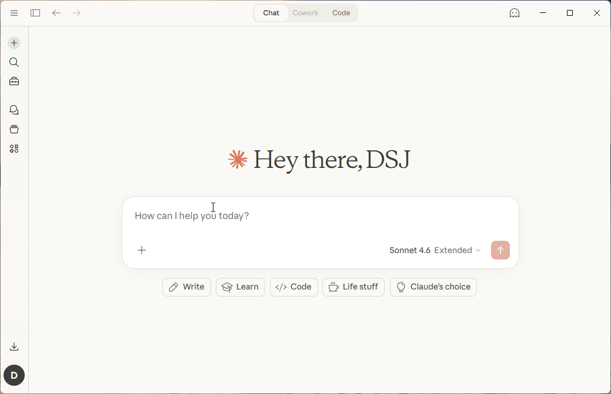
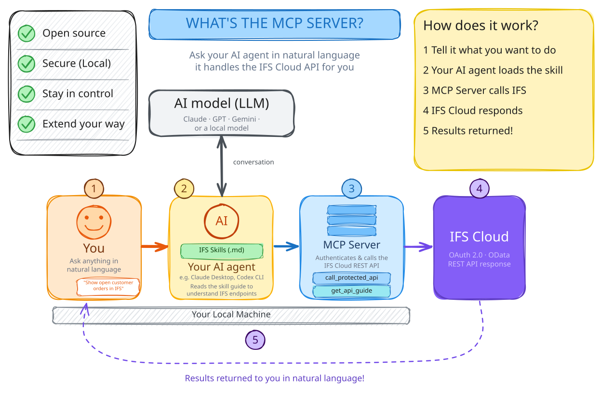

# MCP Server for IFS Cloud

An open source project to connect IFS Cloud to the AI agent you already use. No new platform, no extra product to buy.

This is a standard [Model Context Protocol](https://modelcontextprotocol.io) (MCP) server that runs on your own machine. Use it with **Claude Desktop**, **Claude Code**, **Codex CLI** or any other AI agent that supports MCP. The setup differs per tool; the server is the same.

> [!WARNING]
> This is an **open source initiative**, provided as-is under the MIT license. You are in control of what your AI agent can do with IFS, so **be cautious about using it in production**: start with a test instance and review what the agent does before it changes data. See [Your data and your control](#your-data-and-your-control).

---

## The idea

Connecting an AI agent to IFS Cloud is hard for one reason: the data. IFS exposes its functionality through **projections** (OData endpoints), and there are around 5,000 of them, each with its own data structure. Building an agent that knows all of that is practically impossible.

But nobody uses all of IFS. In their day-to-day work, the average user touches only a handful of screens and needs only the data they see on them.

This project doesn't try to teach an agent everything. It gives you a **framework** to connect IFS Cloud to your AI agent, and lets you build **skills** for the parts of IFS you actually use. You build a skill once, from your own requirements, and then use it however you like.

## What you can do

Ask in plain language, for example:

- *"Find the customer Acme and show me their delivery address."*
- *"Run the quick report 'Session Stats'."*
- *"Export all open purchase orders to a CSV."*
- *"I work in the Purchase Order screen every day. Create a skill so you can help me with it."*

You can register several IFS instances (dev, test, prod), switch between them and mark any of them read-only.

## How it works

The server is a broker between your AI agent and IFS Cloud. It turns requests into IFS API calls and brings the data back. To pick the right endpoint, the agent needs to know your IFS endpoints, and that knowledge lives in **skills**.

### What is a skill?

A skill is a plain Markdown file that describes an IFS area: its endpoints, how to call them and what the data looks like. The agent reads the matching skill *before* it calls an API, so it doesn't have to guess IFS-specific paths and field names.

It ships with skills for finding the projection behind a screen and running Quick Reports, plus guides for OData syntax and for building skills.

**Build your own** (no coding needed):
- **From a screen name:** tell the agent which IFS screen you use. It finds the projection behind it, fetches the live OpenAPI spec and drafts the skill. Best for master data such as customers, suppliers and parts. If you already know the projection name, you can give that instead.
- **From a browser recording:** record your workflow in IFS (DevTools → Network → Save as HAR). The agent extracts the API calls and builds the skill with you. Best for multi-step transactions.
- **Import one:** take a skill from a URL or a local file. Share yours, and find others', in the [community skills repository](https://github.com/knakit/ifs-mcp-skills).

If no skill matches, the agent finds the projection in the IFS navigator and asks before it creates one.

> [!TIP]
> Skills are saved inside the server's own folder by default, so an update can wipe them. Set a **skills directory** (a folder on your machine, or a git repo) before you start building. See [Configuration](docs/getting-started/CONFIGURATION.md).

---

## Your data and your control

- **Runs locally.** The server runs on your machine and talks only to your IFS Cloud instance (and to a URL you give it when importing a skill). No telemetry.
- **Credentials stay local.** OAuth tokens are stored only on your machine, are sent only to your IFS Cloud instance, and are never returned to the agent. The server won't accept a client secret in chat. For headless `client_credentials` login you supply the secret yourself (environment variable or `config.json`).
- **Limit what the agent can do.** Mark an environment `readOnly` to block everything except GET. For a hard limit, use a dedicated IFS user with only the permission sets it needs.
- **Know what reaches the AI model.** Data that a tool returns into the conversation is sent by your AI agent to its model provider. The server does not control that step. The [FAQ](docs/FAQ.md#data-flow-and-privacy) lists, action by action, what the model sees and what stays local.

---

## Quick start

**You need:** an IFS Cloud instance where you can create an OAuth client (or ask your IFS administrator to), an AI agent that supports MCP, and Node.js 18+ if you build from source.

1. **Create an OAuth client in IFS Cloud** (IAM → IAM Clients). See [Installation, step 1](docs/getting-started/INSTALLATION.md).
2. **Install the server** for your AI agent. Claude Code, Codex CLI and other tools run from a local build, so clone this repo and run `npm install && npm run build` first.

| Tool | How |
|---|---|
| **Claude Desktop** | Download the latest `.mcpb` from [GitHub Releases](https://github.com/knakit/ifs-mcp-server-local/releases) and add it as an extension |
| **Claude Code** | `claude plugin marketplace add /path/to/ifs-mcp-server-local`, then `claude plugin install ifs-mcp-server@ifs-local` |
| **Codex CLI** | `codex mcp add ifs -- node /absolute/path/to/ifs-mcp-server-local/build/index.js` |
| **Other MCP tools** | Register `node /absolute/path/to/ifs-mcp-server-local/build/index.js` as a stdio MCP server |

3. **Register your IFS instance** by asking the agent to add an environment ([how](docs/getting-started/ENVIRONMENTS.md)). Claude Desktop also offers a settings dialog.
4. **Log in:** ask the agent to log in to IFS (for a headless `client_credentials` environment this happens automatically).
5. **Build your first skill:** ask the agent to create a skill for a screen you use, for example *"I work in the Purchase Order screen every day. Create a skill so you can help me with it."* It finds the projection behind the screen, fetches the spec from your IFS, asks you a few questions and saves the skill. See [Skill Authoring](docs/guides/SKILL_AUTHORING.md).

Once the skill is saved, ask for what you need in plain language, as in the examples above.

Full steps for each tool are in the **[installation guide](docs/getting-started/INSTALLATION.md)**.

---

## Documentation

| | Document | What's in it |
|---|---|---|
| **Get started** | [Installation](docs/getting-started/INSTALLATION.md) | OAuth client, install for each AI agent, first login |
| | [Managing IFS Environments](docs/getting-started/ENVIRONMENTS.md) | Several IFS instances, interactive vs headless login, read-only |
| | [Configuration](docs/getting-started/CONFIGURATION.md) | Skills directory |
| **Guides** | [Skill Authoring](docs/guides/SKILL_AUTHORING.md) | Build, update and share skills |
| | [FAQ](docs/FAQ.md) | Data flow and privacy, setup and cleanup |
| **Reference** | [Tools, Prompts & Resources](docs/reference/TOOLS.md) | Every tool and prompt |
| | [Architecture](docs/reference/ARCHITECTURE.md) | Components and data flows |
| **Project** | [Contributing](CONTRIBUTING.md) | Share skills, report bugs, develop the server |
| | [Security](SECURITY.md) · [Privacy](PRIVACY.md) | Data handling and vulnerability reporting · privacy policy |

---

MIT licensed. Not affiliated with IFS. Built with the help of [Claude Code](https://claude.ai/claude-code). Shared with love for the IFS Community 💜
